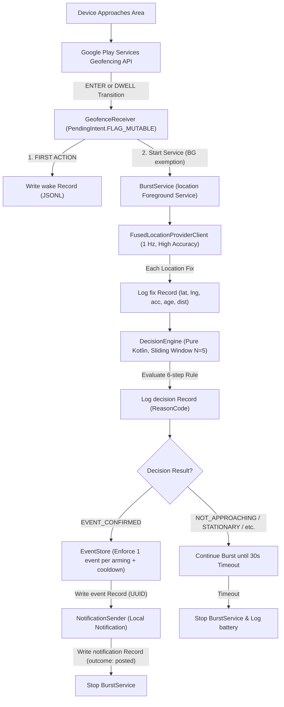

# AMIGO Android Feasibility Test Harness

> **Purpose:** A throwaway test harness built to evaluate native Android OS wake-up behavior, geofence reliability, high-accuracy location burst delivery, and proximity decision logic on real physical devices (both stock Android and OEM distributions such as Samsung, Xiaomi, Oppo, Vivo).
> **Status:** Draft test harness implementation & verification suite.

---

## 1. Core Architecture

The harness decouples three distinct failure domains that competitor apps frequently blur together:
1. **Did the OS wake the app?** (`wake` record)
2. **Did the app have fresh, usable evidence, and what did it decide?** (`fix` and `decision` records)
3. **Did the notification get posted (and manually observed)?** (`event`, `notification`, and `note` records)



---

## 2. Component Directory

| Component | Class | Path | Responsibility |
| :--- | :--- | :--- | :--- |
| **Config** | `Config` | `com.amigo.feasibility.Config` | Target coordinates, arms (50m vs 150m), rule parameters, run label. |
| **Logger** | `Logger` | `com.amigo.feasibility.logger.Logger` | Thread-safe, single-thread executor append-only JSONL logger with monotonic `seq`. |
| **Geofence Manager** | `GeofenceManager` | `com.amigo.feasibility.geofence.GeofenceManager` | Registers and removes circular geofence with `GeofencingClient`. |
| **Geofence Receiver** | `GeofenceReceiver` | `com.amigo.feasibility.geofence.GeofenceReceiver` | Receives geofence broadcast, logs `wake` immediately, starts `BurstService`. |
| **Burst Service** | `BurstService` | `com.amigo.feasibility.burst.BurstService` | Foreground service (`location`), collects 1s fixes, feeds `DecisionEngine`, terminates on timeout or event. |
| **Decision Engine** | `DecisionEngine` | `com.amigo.feasibility.engine.DecisionEngine` | **Pure Kotlin (zero Android imports)**. Evaluates 6-step rule over sliding window of fixes. |
| **Event Store** | `EventStore` | `com.amigo.feasibility.store.EventStore` | Enforces strictly one event per arming cycle and cooldown. Writes `event` record with UUID. |
| **Notification Sender** | `NotificationSender` | `com.amigo.feasibility.notification.NotificationSender` | Posts local notification to `amigo_proximity_channel` and logs separate `notification` record. |
| **Recovery Manager** | `RecoveryManager` | `com.amigo.feasibility.recovery.RecoveryManager` | Re-registers geofence on app restart/boot. **Never generates events or notifications.** |
| **Boot Receiver** | `BootReceiver` | `com.amigo.feasibility.recovery.BootReceiver` | Receives `BOOT_COMPLETED`, logs `wake` with trigger=`boot`, triggers `RecoveryManager`. |
| **Permission Helper** | `PermissionHelper` | `com.amigo.feasibility.permission.PermissionHelper` | Manages Fine Location, Background Location, Notifications, and Battery Optimizations. Logs `permission_change`. |
| **UI** | `MainActivity` | `com.amigo.feasibility.ui.MainActivity` | Single-screen controller: Start/Stop, arm selection, live 50-line JSONL feed, manual notes, and log export. |

---

## 3. Assumptions and Hypothesis Table

Every operational assumption regarding Android platform behavior is cataloged below as a hypothesis. In accordance with Section 12 rules, hypotheses remain unverified until supported by logged field test runs.

| ID | Hypothesis | Rationale / Context | Relevant Matrix Scenario | Initial Status |
| :--- | :--- | :--- | :--- | :--- |
| **H1** | Geofence `ENTER` broadcast reliably wakes a killed or backgrounded process on stock Android. | Android documentation states geofence PendingIntents wake sleeping processes via Play Services. | App backgrounded, Ordinary close, Process kill | **Hypothesis (Awaiting field verification)** |
| **H2** | Starting a foreground service of type `location` from a background geofence `BroadcastReceiver` is permitted on Android 12+ (API 31+). | Android 12 foreground service launch restrictions list geofence transition callbacks as an explicit exemption. | Baseline Positive, Android 12-15 devices | **Hypothesis (Awaiting field verification)** |
| **H3** | A 50-meter geofence fence exhibits significantly higher trigger latency and lower trigger reliability than a 150-meter fence. | GPS and cell/Wi-Fi positioning duty cycles cause geofence boundaries under 100m to be missed at vehicle speeds. | 50m Arm vs 150m Arm (Walking vs Vehicle) | **Hypothesis (Awaiting field verification)** |
| **H4** | Aggressive OEM battery management (e.g. Xiaomi MIUI/HyperOS, Samsung OneUI, Oppo ColorOS) suppresses the geofence wake or kills `BurstService` when running in "Default" battery mode. | Competitor reminder failures often cluster on OEM devices due to proprietary background killers. | OEM phone: Default vs Unrestricted battery mode | **Hypothesis (Awaiting field verification)** |
| **H5** | Device reboot clears active geofences, but `BOOT_COMPLETED` will successfully re-register them without generating phantom notifications. | Play Services clears registered geofences on reboot. `BootReceiver` must re-arm cleanly without replaying past events. | Reboot scenario | **Hypothesis (Awaiting field verification)** |
| **H6** | Swipe from Recents ("Ordinary Close") terminates active foreground services on certain OEM skins, preventing burst completion. | Stock Android keeps foreground services running on swipe from recents, but some OEM ROMs treat it as a task kill. | Ordinary Close scenario | **Hypothesis (Awaiting field verification)** |
| **H7** | Doze Mode (`dumpsys deviceidle force-idle`) delays geofence wake-up until the next Doze maintenance window. | In deep Doze, network and non-high-priority alarms are batched, which may defer geofence evaluation. | Doze / battery restrictions test | **Hypothesis (Awaiting field verification)** |

---

## 4. Build, Installation, and Test Execution

### Prerequisites
- JDK 17 (Microsoft OpenJDK 17 installed)
- Android SDK with Platforms 34/35 and Build-Tools
- A physical Android device with Google Play Services and USB/Wireless Debugging enabled.

### 1. Build and Run Unit Tests
To verify the pure-Kotlin `DecisionEngine` against synthetic traces covering all reason codes:
```powershell
.\gradlew testDebugUnitTest
```
*Expected output: All 8 unit tests in `DecisionEngineTest` pass cleanly.*

### 2. Assemble Debug APK
```powershell
.\gradlew assembleDebug
```
The output APK is generated at:
`app\build\outputs\apk\debug\app-debug.apk`

### 3. Install on Physical Device via ADB
```powershell
adb install -r app\build\outputs\apk\debug\app-debug.apk
```

---

## 5. Exporting and Pulling Test Logs

### Option A: In-App Export (Share Sheet)
1. In the app UI, tap **Export Logs (Share Sheet)**.
2. Share the generated `.jsonl` log file directly to Google Drive, Email, Slack, or save to device storage.

### Option B: Pull Logs via ADB
The app runs with debuggable applicationId `com.amigo.feasibility.debug`:
```powershell
# List log files on device
adb exec-out run-as com.amigo.feasibility.debug ls -l files/logs/

# Pull all JSONL logs to local laptop directory
adb exec-out run-as com.amigo.feasibility.debug sh -c 'tar -cf - -C files/logs .' | tar -xf - -C ./test_runs/
```
Alternatively, pull a specific run file:
```powershell
adb exec-out run-as com.amigo.feasibility.debug cat files/logs/amigo_RUN_xxxx.jsonl > ./test_runs/run_output.jsonl
```

---

## 6. Decision Engine & Reason Codes

The `DecisionEngine` operates on a sliding window of recent fixes (`Config.WINDOW_N = 5`, `Config.MIN_VALID_FIXES = 3`).

| Reason Code | Description | Confirmation Result |
| :--- | :--- | :--- |
| `EVENT_CONFIRMED` | Fresh, accurate fixes inside proximity radius showing sustained decrease in distance and net displacement. | **True** (Triggers `EventStore` & `NotificationSender`) |
| `INSUFFICIENT_FIXES` | Fewer than `MIN_VALID_FIXES` in the window. | **False** |
| `STALE_FIXES` | Fixes rejected because age exceeds `MAX_FIX_AGE_MS` (10s). | **False** |
| `LOW_ACCURACY` | Fixes rejected because horizontal accuracy exceeds `MAX_ACCURACY_M` (25m). | **False** |
| `OUTSIDE_PROXIMITY` | Latest fix distance exceeds `PROXIMITY_M` (40m). | **False** |
| `STATIONARY` | Net displacement across the window is below `STATIONARY_M` (5m). | **False** |
| `NOT_APPROACHING` | Distance trend is flat, increasing, or has fewer than `MIN_DECREASING_STEPS` (2). | **False** |
| `CONFLICTING` | Approach magnitude is smaller than GPS accuracy noise or fixes oscillate erratically. | **False** |

---

## 7. Bounded Battery Observation Procedure

To observe energy consumption per wake/burst:
1. Reset batterystats before a test run:
   ```powershell
   adb shell dumpsys batterystats --reset
   ```
2. Unplug USB and execute the test run over Wi-Fi debugging.
3. Once the run concludes, dump the batterystats for the package:
   ```powershell
   adb shell dumpsys batterystats com.amigo.feasibility.debug
   ```
4. Record observed battery drain, burst duration, and number of fixes collected.

